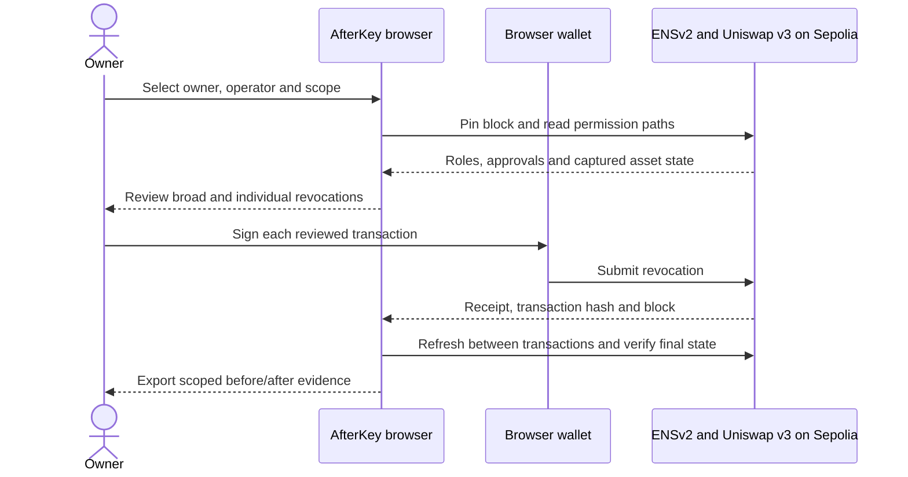
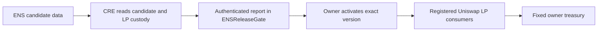
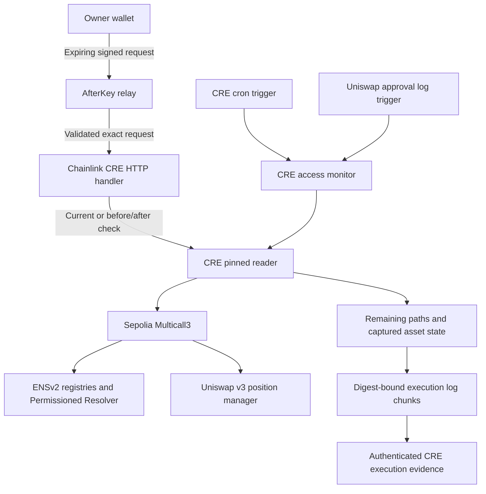

<p align="center"></p>

# AfterKey — A Release Gate for Shared ENS Configuration, Enforced on Uniswap v3 LP Positions

**AfterKey closes the access path a narrow revoke leaves open — an owner stages a config change in an ENSv2 record, Chainlink CRE independently re-reads ENS and every Uniswap v3 LP consumer before anything goes live, and only the exact version CRE checked can ever be activated.**

ENS stores the policy. Chainlink CRE independently verifies it against live chain state. Uniswap v3 consumers enforce it on every collection call, not once.

Built at ETHGlobal Mumbai 2026 · Live on Ethereum Sepolia · Tracks: ENS — Best Use of ENSv2, Uniswap Foundation — Build with Uniswap, Chainlink — Best Workflow with CRE

## The Problem in One Sentence

Teams and agents read operators, treasuries and limits from shared ENS records, but removing the one permission a departing teammate is known to hold does not remove a broader role sitting one level up — so the access the team thinks is gone can still move funds.

## Why This Matters — Context

| Fact | Detail | Source |
| --- | --- | --- |
| Offboarding doesn't finish | 91% of former-employee tokens remain active after offboarding completes. | [State of NHIs and Secrets, cited by NHI Mgmt Group](https://nhimg.org/articles/off-boarding-gaps-in-cloud-access-create-identity-risk/) |
| Over-provisioning is the default, not the exception | An estimated 97% of non-human identities carry more privilege than they use. | [NHI Mgmt Group](https://nhimg.org/articles/identity-blast-radius-how-overprovisioning-magnifies-breach-damage/) |
| Credential/access abuse is still a leading breach path | Credential abuse appears somewhere in the attack chain of 39% of breaches in the 2026 Verizon DBIR. | [2026 Verizon DBIR, cited by NHI Mgmt Group](https://nhimg.org/articles/2026-verizon-dbir-shows-vulnerability-exploitation-has-overtaken-credentials/) |
| ENS's own access-control model makes this concrete | A text-key role and a resolver-wide role are separate grants under Enhanced Access Control; revoking one leaves the other fully active — this is documented ENS behavior, not a bug. | `hasRoles` checks in [`src/ens/protocol.ts`](src/ens/protocol.ts), verified on real Sepolia state in [`ens-offboarding-verification.json`](docs/ens/proofs/ens-offboarding-verification.json) |

The gap is structural, not hypothetical: the same narrow-permission trap that shows up in general IT offboarding statistics is reproducible, on real testnet state, in ENSv2 and in Uniswap v3 approvals — which is exactly what AfterKey's own verified evidence below demonstrates.

## Three Layers of the Problem

**1. Shared config, no review.** Operators, treasuries and limits live in ordinary ENS records. Anyone holding a role can change them, and nothing independently checks what depends on that record before the change takes effect.

**2. A narrow revoke proves nothing.** Removing a text-key permission does not remove a resolver-wide role. A departing operator — or a compromised one — can keep access the team believes is gone, because "we revoked it" was never independently re-checked against the full permission surface.

**3. Assets sit at the end of the chain.** Uniswap v3 LP positions, and their approvals, follow whatever that ENS config currently says. A stale or wrong record means collected fees flow to the wrong operator — and ordinary ERC-721 approval checks don't distinguish "can manage this position" from "can only collect fees."

## The Solution — AfterKey

Stage in ENS. Verify with Chainlink CRE. Activate for your LP positions.

```
Without AfterKey:
  revoke   = team removes the one permission it remembers   ← narrow, incomplete
  role     = a broader resolver-wide/portfolio-wide grant survives ← invisible, unverified
  config   = the owner trusts a change on faith               ← no independent check
  "safe"   = assumed once, never re-checked                   ← stale by the next block

With AfterKey:
  scan     = EAC roles + registry resources + Uniswap approvals  ← both scopes, both protocols
  stage    = candidate (operator, treasury, expiry) written to an ENSv2 data record ← public, nothing live yet
  verify   = Chainlink CRE independently re-reads ENS + every registered LP consumer
  activate = owner signs the exact digest and epoch CRE checked  ← consumers enforce it on every call
```

A violation of the staged policy isn't an opinion — it's `authorize(operator)` returning false against the one digest the gate has marked active, computable by anyone reading the same ENS record and the same chain state AfterKey reads.

AfterKey ships two complete, independently verified capabilities:

- **Configuration review (new):** the release-gate workflow above — stage, verify, activate, enforce.
- **Offboarding (original, fully proven on Sepolia):** discover every surviving access path across ENSv2 and Uniswap v3 for a departing wallet, prepare owner-reviewed broad-first revocations, and verify afterward that the team's identity and positions are untouched.

## What Makes AfterKey Unique

| Capability | Revoke.cash-style revocation tools | Multisig/Timelock governance (e.g. Safe + Zodiac) | One-time manual audit | AfterKey |
| --- | --- | --- | --- | --- |
| Finds the *surviving* access path, not just the one you already suspect | ❌ lists approvals, doesn't model dependency | ❌ | ✅ once, then stale | ✅ live, every scan |
| Reviews a config change *before* it's trusted | n/a — reactive only | ✅ manual review | ✅ | ✅ staged ENS candidate |
| Independent re-verification against live chain state | ❌ | ❌ | ❌ point-in-time | ✅ Chainlink CRE, every request |
| Owner-gated activation of the *exact checked version* | n/a | ✅ (execution), not config-bound | n/a | ✅ digest + epoch bound |
| Spans identity (ENS) *and* delegated assets (Uniswap LP) in one model | ❌ | ❌ | partial, manual | ✅ |

AfterKey is not a revocation tool like Revoke.cash — it's a *review gate* for config an owner is about to trust, and a *permissions state check*, not a privileged-call simulation.

## Technical Architecture

### System Overview

```
┌─────────────────────────── Owner / Browser ───────────────────────────┐
│  Vite + TypeScript app (src/)                                          │
│  Workflow:    1. Setup → 2. Review change → 3. Run workflow → 4. Evidence │
│  Offboarding: ENS identity → Uniswap positions → Activity → Chainlink  │
│  Reads ENSv2 + Uniswap v3 directly via viem; wallet signs every change │
└───────────────┬───────────────────────────────┬────────────────────────┘
                │ wallet transactions            │ 5-min, body-bound signed HTTP
                ▼                                ▼
┌───────────────────────────┐    ┌────────────────────────────────────────┐
│  Ethereum Sepolia          │    │  Signed CRE relay                      │
│                            │    │  (server/, api/cre-trigger.ts,         │
│  ENSv2                     │    │   worker/ — Node, Vercel fn, Worker)   │
│   ├─ ETHRegistrar          │    │  Verifies signature, exact body,       │
│   ├─ UserRegistry          │◀───┤  expiry, event-specific input and      │
│   └─ Permissioned Resolver │    │  deployed scope before forwarding      │
│  ENSReleaseGate            │    └──────────────────┬──────────────────── ┘
│   ├─ digest · epoch ·      │                        │
│   │  expiry · workflowId   │                        ▼
│   └─ authorize(operator)   │            ┌─────────────────────────────┐
│  ReleaseLPVault ×N         │◀──signed───│  Chainlink CRE              │
│   ├─ one Uniswap v3 NFT    │   report   │  cron · HTTP · EVM-log      │
│   └─ collect() gated on    │            │  triggers; independently    │
│      gate.authorize()      │            │  re-reads ENS + every       │
│  Uniswap v3 Position       │            │  registered consumer        │
│  Manager (official)        │            └─────────────────────────────┘
└────────────────────────────┘
```

### Contracts and core modules

| Component | Role |
| --- | --- |
| [`ENSReleaseGate.sol`](contracts/ENSReleaseGate.sol) | Version-bound release gate: stores the candidate digest, epoch and expiry; accepts only a Chainlink CRE-signed report; lets only the owner activate; authorizes the exact operator for the exact active version. |
| `ReleaseLPVault` (in `ENSReleaseGate.sol`) | Holds exactly one Uniswap v3 NFT; [`collect()`](contracts/ENSReleaseGate.sol#L124) asks `ENSReleaseGate.authorize()` before every official-manager `collect` call; [`release()`](contracts/ENSReleaseGate.sol#L130) returns the NFT to the owner independent of ENS state. |
| [`ENSPositionVault.sol`](contracts/ENSPositionVault.sol) | A second consumer pattern: [`canCollect`](contracts/ENSPositionVault.sol#L71) calls the Permissioned Resolver's `hasRoles` **live, at call time** — a role revoked in ENS blocks the very next collection with no separate sync step. |
| [`cre/main.ts`](cre/main.ts) | The Chainlink CRE workflow: cron, HTTP and EVM-log triggers; independently re-reads ENSv2 and every registered Uniswap consumer; writes the signed release report through the CRE forwarder. |
| [`src/engine.ts`](src/engine.ts) | Permission scans, residual-path discovery, revocation ordering, per-block read caching, owner-preservation checks — the offboarding engine. |
| [`src/ens/`](src/ens), [`src/uniswap/`](src/uniswap), [`src/releases/`](src/releases) | Live ENS hierarchy/profile discovery and setup; Uniswap v3 position reads and action policy; the Setup → Review → Run → Evidence workflow client. |
| [`server/cre-worker.ts`](server/cre-worker.ts) / [`api/cre-trigger.ts`](api/cre-trigger.ts) | The portable signed relay: rejects unsigned, expired, oversized, malformed or altered requests before forwarding to the fixed CRE gateway. |

## How Each Sponsor's Stack Is Used

### ENS — the policy is the name (ENSv2, Sepolia beta)

- **Namespace and identity:** `manager.eth` → `treasury-agent.manager.eth` (offboarding) and `afterkey-release.manager.eth` (release gate), both real registered subnames read through the live ENSv2 hierarchy — the official Verifiable Factory, Permissioned Resolver and User Registry implementations, never a hard-coded address.
- **Both permission scopes, every time:** AfterKey reads `hasRoles` for the text-key role *and* the resolver-wide role via Enhanced Access Control, plus registry roles that can redirect a name/subregistry and ERC-1155 operator approval — distinguishing ordinary from admin authority.
- **The candidate config lives in an ENS record:** `afterkey.release` is published as an ENS **data** record (ABI-encoded operator, treasury, manager, expiry) and hashed into the digest CRE checks and the gate enforces.
- **Resolved fresh:** every read goes through the live resolver at the current block — nothing is cached as ground truth across sessions.

### Uniswap v3 — delegated liquidity, two independent approval paths

- **Official contracts only:** the Sepolia `NonfungiblePositionManager` at [`0x1238536071E1c677A632429e3655c799b22cDA52`](https://sepolia.etherscan.io/address/0x1238536071E1c677A632429e3655c799b22cDA52) — no custom wrapper, no proxy AfterKey controls.
- **Individual vs. portfolio approval, modeled separately:** AfterKey reads `getApproved` and `isApprovedForAll` independently and will not call an offboard "complete" until both are gone — exactly the gap documented in [`FEEDBACK.md`](FEEDBACK.md).
- **Collect-only consumers:** `ReleaseLPVault` and `ENSPositionVault` each hold one position NFT and can only call `collect`, never withdraw liquidity; the recipient is fixed to the owner treasury at deployment.
- **Six reviewed operations:** individual/portfolio delegation and revocation, collection to the owner, and owner-reviewed liquidity withdrawal — see [`src/uniswap/positions.ts`](src/uniswap/positions.ts).

### Chainlink CRE — the independent second check

- **Three real triggers:** an owner-signed, body-bound HTTP request (5-minute expiry, relayed and verified before it ever reaches the CRE gateway); a cron recheck; and an EVM-log trigger on Uniswap approval events — see [`cre/main.ts`](cre/main.ts).
- **Signed, on-chain report:** delivered through the CRE forwarder (`KeystoneForwarder`); `ENSReleaseGate` checks the forwarder, workflow ID, workflow owner, chain, candidate digest, baseline epoch, coverage hash and report validity window before accepting it.
- **Never holds the key:** CRE verifies and reports; every revocation and every activation remains wallet-signed by the owner. CRE cannot execute an owner action on its own.
- **Short-lived by design:** reports expire quickly, so a stale "pass" can't be replayed against a later, different configuration.

## Full Flows

### Owner-reviewed offboarding



### Configuration release — stage, verify, activate



### Independent CRE monitoring



## Security Model

**What AfterKey checks, and what it doesn't.** A closed offboarding result means no modeled path was found in the *configured* scope at the recorded block — other wallets, signed permits, unknown contracts, social recovery and unconfigured resources are outside coverage. AfterKey does not describe a read-only check as an executed attack attempt or as universal proof of no access, and it includes no privileged-call simulations.

**Non-negotiable invariants**

- `ReleaseLPVault.collect()` and `ENSPositionVault.canCollect()` both re-check authorization live at call time — a revoked role or a demoted version blocks the *next* collection, not just future ones.
- `ENSReleaseGate` accepts only a correctly forwarded, digest-bound, epoch-bound, not-yet-expired CRE report — never an owner- or UI-asserted claim.
- Collection recipients are fixed to the owner treasury; operators can collect fees, never withdraw liquidity or transfer the NFT out through the consumer.
- Every revocation and every activation is signed individually by the owner's own wallet; broad-first execution is not atomic and does not eliminate mempool races.

**Trust assumptions, stated openly**

- Sepolia only; this is not an audited production security product.
- The default public RPC falls back to viem's Sepolia default on provider failures, with reads pinned to the requested block; a custom RPC is used exclusively, without that fallback.
- Reads are cached only within one block snapshot; incomplete reads and empty protocol scope cannot produce a closed result.
- CRE reports and owner-signed receipts are separate evidence; recorded CRE execution status is an observation, not a browser health poll.

**Known limits:** the position workspace bounds discovery to 50 NFTs, the offboarding scanner to 200; incomplete coverage blocks execution. Dependency coverage compares known names at their own observation blocks, not one atomic global snapshot — see [`configuration-releases.md`](docs/release-gate/configuration-releases.md) for the full boundary.

## Deployed Contracts — Sepolia Testnet

Owner: `0x2cE812CF03d1F252C940aFf954E15D5E49bBedd5` · Operator: `0x22225204824EdF00b3c8c32A43f1C04246e2d1b4`

| Contract / resource | Address |
| --- | --- |
| `ENSReleaseGate` | [`0x47ae5aF5A9A2D0e90D2986861aD99f088270258F`](https://sepolia.etherscan.io/address/0x47ae5aF5A9A2D0e90D2986861aD99f088270258F) |
| `ReleaseLPVault` — position 234145 | [`0x5e8E5C0503527e8DcAc763f992336a9DC5465cDd`](https://sepolia.etherscan.io/address/0x5e8E5C0503527e8DcAc763f992336a9DC5465cDd) |
| `ReleaseLPVault` — position 234146 | [`0x65E74c5DFb833E9bC1798954da416b8D1aea4460`](https://sepolia.etherscan.io/address/0x65E74c5DFb833E9bC1798954da416b8D1aea4460) |
| ENS identity — release gate | `afterkey-release.manager.eth`, resolver [`0xd629d7De9c72684d27682Ed3C503283314906c24`](https://sepolia.etherscan.io/address/0xd629d7De9c72684d27682Ed3C503283314906c24) |
| ENS identity — offboarding | `treasury-agent.manager.eth`, Permissioned Resolver [`0x6161ada4D10a529940B90b078B4F9A8d3679c8f8`](https://sepolia.etherscan.io/address/0x6161ada4D10a529940B90b078B4F9A8d3679c8f8), subname registry [`0x26560685235D2d7861afF80866E8C1846d14420D`](https://sepolia.etherscan.io/address/0x26560685235D2d7861afF80866E8C1846d14420D) |
| Uniswap v3 Position Manager (official) | [`0x1238536071E1c677A632429e3655c799b22cDA52`](https://sepolia.etherscan.io/address/0x1238536071E1c677A632429e3655c799b22cDA52) |
| Chainlink CRE workflow | `afterkey-departure-verifier`, workflow ID `0x008b8fff1c0118afc754c6f524fb07be206d2bae97d7d0167cf035ac599daa20`, status `ACTIVE` ([`cre/deployment.json`](cre/deployment.json)) |

## Live Proof (real Sepolia transactions)

| Evidence | Reference |
| --- | --- |
| Final owner-approved ENS revocation | [Successful receipt](https://sepolia.etherscan.io/tx/0xbe002b4c04dc64da5ab12fde4c449f25010bc78fc3044f86dd46c29849e7f241), block 12,074,044 — [ten full setup/delegation/update/revocation receipts](docs/validation/transactions.md) |
| ENS identity and owner preservation | [30 independent historical-state checks](docs/ens/proofs/ens-offboarding-verification.json) across blocks 12,074,041 and 12,074,046 — all passed |
| Complete Uniswap offboarding | [Final portfolio revocation](https://sepolia.etherscan.io/tx/0x2a4ca9ba41a8fe0d11f8d8eeba69a9a50dee27841b80e8c0905366e5032671f8) at block 12,075,584; [14 historical-state and policy checks](docs/uniswap/proofs/uniswap-offboarding-verification.json) for positions 234145 and 234146 |
| Chainlink external-case verification | [Authenticated execution proof](docs/chainlink-cre/proofs/cre-execution-proof.json): run `f42d1d27-6bcf-4689-b290-d4d533f83729`, 18 strict collector checks, [completed GitHub case](https://github.com/Lakshmikanth-3/AfterKey/issues/2) |
| Chainlink scheduled monitoring | [Archived scheduled proof](docs/chainlink-cre/proofs/cre-scheduled-execution-proof.json): run `4a9f683b-50a0-4645-873d-d838400d21b6`, Sepolia block 12,074,459 |
| Release-gate consumer deployment and custody | [NFT 234145](docs/release-gate/proofs/release-replacement-consumer-234145.json), [NFT 234146](docs/release-gate/proofs/release-replacement-consumer-234146.json), both deposited with nonzero liquidity |
| CRE workflow bound to the release gate (owner-signed in MetaMask) | Confirmed at block 12,080,625; release version 2 → 3 — visible in the app's **4. Evidence** tab |
| Live ENSv2 deployment verification | [Factory provenance, current implementations and permission scan](docs/ens/proofs/ens-live-read-check.json) |

This repository's own `docs/*/proofs/` folders carry the machine-readable version of every row above, grouped by sponsor track.

## Repository Structure

```
afterkey/
├── contracts/                   # ENSReleaseGate.sol, ENSPositionVault.sol, test fixtures
├── cre/                         # Chainlink CRE workflow (cron, HTTP, EVM-log triggers)
├── src/                         # Vite + TypeScript app
│   ├── ens/                     # Live hierarchy/profile discovery, setup, delegation demo
│   ├── uniswap/                 # Position reads, approvals, action policy
│   ├── cre/                     # Browser-side auth for the signed relay
│   ├── releases/                # Setup → Review change → Run workflow → Evidence client
│   ├── guarded/                 # Shared guarded-action primitives
│   └── engine.ts                # Permission scans, residual paths, preservation checks
├── server/, api/, worker/       # Signed CRE relay and policy (Node server, Vercel fn, Worker build)
├── scripts/                     # Compilation, plus verify-*/collect-* proof-producing scripts
├── tests/                       # npm test: engine, ENS, CRE relay/policy, vault tests
├── docs/                        # Documentation index, grouped by sponsor track + proofs/
└── FEEDBACK.md                  # Uniswap developer feedback (public, submitted)
```

## Tech Stack

| Layer | Technology |
| --- | --- |
| Smart contracts | Solidity, compiled via `solc` 0.8.30 ([`scripts/compile-release.mjs`](scripts/compile-release.mjs)) |
| ENS | ENSv2 Sepolia beta — ETHRegistrar, User Registry, Permissioned Resolver, Verifiable Factory, Enhanced Access Control |
| Uniswap | Official Sepolia v3 `NonfungiblePositionManager` — approvals, collection, `multicall` |
| Chainlink | CRE SDK `@chainlink/cre-sdk`, cron/HTTP/EVM-log triggers, `KeystoneForwarder` |
| Frontend | Vite 6, TypeScript, [`viem`](https://viem.sh), `lucide` |
| Backend / relay | Node (`tsx`) server, Vercel function, Cloudflare Worker build |
| Network | Ethereum Sepolia |

## Local Setup

Node.js 22.9+ (22.x line) is required. A browser wallet on Sepolia is required for signing.

```sh
npm install
npm run dev          # http://127.0.0.1:5173
npm test
npm run build
npm run verify:ens
```

`verify:ens` performs ordinary view reads on real Sepolia deployments — it never sends a transaction. Pass a workspace name, as in `npm run verify:ens -- treasury-agent.manager.eth`, to additionally verify official factory provenance and current proxy implementations. Set `SEPOLIA_RPC_URL` in the environment to use a different RPC.

Copy `.env.example` to `.env` and optionally set `SEPOLIA_RPC_URL`. `.env`, environment variants, signing keys and credential files are excluded from Git — only `.env.example` contains shareable defaults. Never place a private key or secret in a `VITE_*` variable: browser build variables are public.

## Deploy (Sepolia)

```sh
npm run build              # local Node server build, includes the signed relay
npm start                  # serve the build locally
npm run build:vercel       # browser assets + api/cre-trigger.ts handler
```

For the release-gate workflow specifically: deploy `ENSReleaseGate`, deploy/register/deposit one `ReleaseLPVault` per NFT, export CRE coverage from **1. Setup**, deploy the Chainlink CRE workflow, then bind the returned workflow ID in the app — see the full staged walkthrough in [`docs/release-gate/configuration-releases.md`](docs/release-gate/configuration-releases.md).

## End-to-End Test Flow

1. **Connect wallet** — MetaMask on Sepolia, matching the configured owner.
2. **Workflow → 1. Setup** — deploy or refresh the release gate; register and deposit the LP consumer for each owned Uniswap v3 NFT.
3. **Bind the CRE workflow** — review the exact calldata (`Bind CRE workflow`, invalidates pending reports and increments the release version), then sign in MetaMask.
4. **2. Review change** — publish a candidate (operator, treasury, expiry) to the ENS record; request CRE verification.
5. **3. Run workflow** — once a signed report lands, activate the exact checked digest; the operator can now collect, paid only to the fixed owner treasury.
6. **4. Evidence** — every confirmed transaction, block and signer, exported alongside live reads.
7. **Offboarding** (original workflow) — **ENS identity** → audit a namespace, review effective roles; **Uniswap** → discover individual and portfolio approvals; **Offboarding** → broad-first revocation plan with per-transaction receipts; **Activity** → confirmed transaction history.

## Testing

```sh
npm test
```

Covers the offboarding engine, ENS resource/role/grant/deployment-event checks, CRE relay/policy validation, and vault invariants (deterministic salts, ownership, collect-only enforcement).

## Sponsor Tracks

- **ENS — Best Use of ENSv2:** central, functional ENSv2 integration (not a display-name feature) — live hierarchy, Permissioned Resolver, Enhanced Access Control, a candidate config stored as an ENS data record. Public source and a public demo.
- **Uniswap Foundation — Build with Uniswap:** official v3 NFTs, both approval paths modeled independently, collect-only consumer contracts, fixed-treasury recipients. `FEEDBACK.md` published and the [required developer form](https://developers.uniswap.org/hackathon-feedback) submitted.
- **Chainlink — Best Workflow with CRE:** three real trigger types, signed on-chain reports through the CRE forwarder, an independently re-verified release gate that nothing can activate without a current, matching report.

## Documentation

[Documentation index](docs/README.md) · [Architecture](docs/overview/ARCHITECTURE.md) · [Configuration releases](docs/release-gate/configuration-releases.md) · [Demo script](docs/overview/DEMO.md) · [Showcase copy](docs/overview/SHOWCASE.md) · [ENS qualification review](docs/ens/ENS_QUALIFICATION_REVIEW.md) · [Uniswap qualification review](docs/uniswap/UNISWAP_QUALIFICATION_REVIEW.md) · [Chainlink CRE review](docs/chainlink-cre/CHAINLINK_CRE_REVIEW.md) · [E2E status](docs/validation/E2E_STATUS.md) · [AI attribution](docs/overview/AI_ATTRIBUTION.md)

## Acknowledgements

- **ENS** — ENSv2, Permissioned Resolver, Enhanced Access Control, Verifiable Factory
- **Uniswap** — v3 core and periphery, the official Sepolia Position Manager
- **Chainlink** — CRE, cron/HTTP/EVM-log triggers, the Keystone Forwarder
- **viem**, Vite, TypeScript

## License

MIT
