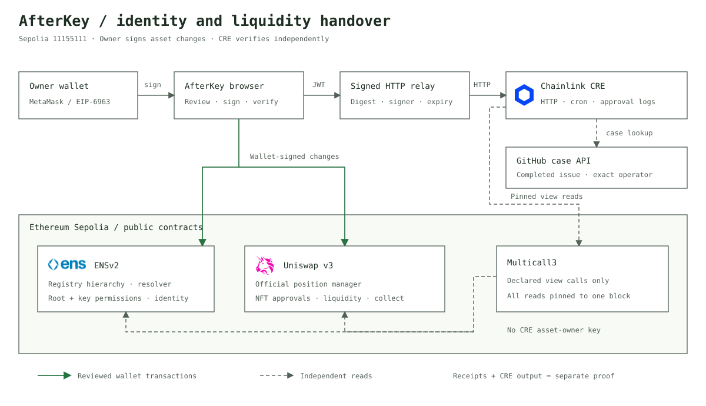

# AfterKey

**Review the change. Protect what depends on it.**

AfterKey reviews shared ENS configuration before an owner activates it for treasury workflows. ENSv2 stores the candidate, Chainlink CRE checks the exact version and registered consumers, and Uniswap LP contracts enforce the approved configuration. The existing offboarding tools remain available for recovery and permission cleanup.

## Start here

1. Run `npm run dev` in this repository and open **http://127.0.0.1:5173/?step=setup**.
2. Use **Change review → Set up consumers** to deploy the release gate, then deploy, register and deposit the LP consumers with the owner wallet.
3. Follow the [configuration release guide](docs/configuration-releases.md) to configure/deploy CRE, verify a candidate, activate it and collect using the approved version.

**Current boundary:** the configuration-review extension is local and requires live deployment/report/transaction proof. The public Vercel app and historical evidence below cover the earlier offboarding workflow. Do not repeat ENS name registration or mint new positions just to start this extension.

Live application: **https://afterkey.vercel.app**. Source: https://github.com/Lakshmikanth-3/AfterKey. The Vercel app is publicly accessible, includes the signed CRE relay, and reads real Sepolia state. The earlier Sites deployment remains private by the owner’s choice. [Deployment checks](docs/vercel-deployment-verification.json).

## Configuration review extension

The new **Change review** workspace stages ENS configuration, shows known shared-record dependencies, requests a version-bound CRE report, and lets the owner activate that exact version for registered Uniswap LP consumers. Contracts reject stale versions and unauthorized recipient changes. [Implementation, setup and proof boundaries](docs/configuration-releases.md).

**Status:** implemented locally; new gate/consumer deployment and live CRE report delivery still require verification. The archived receipts below demonstrate the existing offboarding flow, not this extension.

## Verify the implementation

| Evidence | Open it |
| --- | --- |
| ENS owner-approved revocation | [Successful Sepolia receipt](https://sepolia.etherscan.io/tx/0xbe002b4c04dc64da5ab12fde4c449f25010bc78fc3044f86dd46c29849e7f241), [ten setup/delegation/update/revocation receipts](docs/transactions.md) |
| ENS identity and owner preservation | [30 historical-state checks](docs/ens-offboarding-verification.json) across blocks 12074041 and 12074046 |
| Complete Uniswap offboarding | [Successful final revocation](https://sepolia.etherscan.io/tx/0x2a4ca9ba41a8fe0d11f8d8eeba69a9a50dee27841b80e8c0905366e5032671f8) at block 12075584; [14 historical-state and policy checks](docs/uniswap-offboarding-verification.json) for positions 234145 and 234146 |
| Chainlink external-case verification | [Authenticated execution proof](docs/cre-execution-proof.json): successful HTTP run `f42d1d27-6bcf-4689-b290-d4d533f83729` with 18 strict collector checks, [completed GitHub case](https://github.com/Lakshmikanth-3/AfterKey/issues/2), and [nine departure checks](docs/cre-departure-verification.json) |
| Chainlink scheduled monitoring | [Archived scheduled proof](docs/cre-scheduled-execution-proof.json): successful run `4a9f683b-50a0-4645-873d-d838400d21b6`, Sepolia block 12074459; [approval-event proof](docs/cre-approval-event-proof.json) |
| Actual ENSv2 workspace | [Permissioned Resolver](https://sepolia.etherscan.io/address/0x6161ada4D10a529940B90b078B4F9A8d3679c8f8), [subname registry](https://sepolia.etherscan.io/address/0x26560685235D2d7861afF80866E8C1846d14420D) |
| Live ENSv2 deployment verification | [Factory provenance, current implementations and permission scan](docs/ens-live-read-check.json), [security review](docs/ENS_SECURITY_REVIEW.md) |
| Official Uniswap integration | [Sepolia v3 position manager](https://sepolia.etherscan.io/address/0x1238536071E1c677A632429e3655c799b22cDA52), [six reviewed operations](src/uniswap/positions.ts#L36) |

## Sponsor requirement mapping

Checked against the [ETHGlobal Mumbai sponsor requirements](https://ethglobal.com/events/mumbai/prizes). Implementation and demonstrated execution are recorded separately.

| Prize | Requirement | Current status and evidence |
| --- | --- | --- |
| ENS — Best Use of ENSv2 | ENSv2 on mainnet or Sepolia, central and functional integration | Sepolia hierarchy, Permissioned Resolver, EAC delegation and offboarding; [live discovery](src/ens/protocol.ts#L32), [independent access paths](src/engine.ts#L67), [receipts](docs/transactions.md) |
| ENS — Best Use of ENSv2 | Open source and a live demo link in the showcase | Public MIT source and the public Vercel demo are available; attach both links to the showcase |
| Uniswap — Build with Uniswap | Meaningful use of the stack, with clear implementation pointers | Official v3 NFTs, approvals, collection and withdrawal; [portfolio reads](src/uniswap/positions.ts#L11), [action policy](src/uniswap/positions.ts#L36), [preservation](src/engine.ts#L167). [Two owner-held mints](docs/uniswap-mint-verification.json), [operator collection](docs/uniswap-operator-verification.json) and [complete offboarding](docs/uniswap-offboarding-verification.json) verified. Optional withdrawal is implemented but was not executed in this preservation demo |
| Uniswap — Build with Uniswap | Public source, FEEDBACK.md and developer feedback form | [Feedback file](FEEDBACK.md) is published and the [required form](https://developers.uniswap.org/hackathon-feedback) was submitted with its public link; [confirmation](docs/uniswap-feedback-confirmation.png) |
| Chainlink — Best workflow with CRE | Blockchain plus external API/system, meaningful orchestration | [GitHub case reads](cre/external-case.ts#L4), [signed HTTP routing](cre/main.ts#L26), [cron](cre/main.ts#L40), [approval events](cre/main.ts#L43). [Successful departure verification](docs/cre-departure-verification.json) joins GitHub issue 2 with Sepolia state |
| Chainlink — Best workflow with CRE | Live deployment or successful workflow execution | [ACTIVE deployment](cre/deployment.json), [current signed HTTP execution](docs/cre-execution-proof.json), and archived [scheduled](docs/cre-scheduled-execution-proof.json) / [approval-event](docs/cre-approval-event-proof.json) executions. The current run compares blocks 12075512 and 12075653 and reports preserved assets with permissions absent |

## Uniswap judge verification

The **$10,000 Build with Uniswap** prize accepts v3 protocol integrations; an API key or v4 hook is not required by the [Mumbai rules](https://ethglobal.com/events/mumbai/prizes). The separate $5,000 pool requires Continuity Track participation, which is not established by this repository.

These code links pin the reviewed source so their line numbers remain stable:

| Verify | Exact source or proof |
| --- | --- |
| Official Sepolia manager and ABI | [Contract address and ABI](https://github.com/Lakshmikanth-3/AfterKey/blob/87cccbcaef14fe71f4ca16b15f65faf9e601fb2e/src/uniswap/contracts.ts#L4) |
| Live NFTs and both approval paths | [Portfolio reads](https://github.com/Lakshmikanth-3/AfterKey/blob/87cccbcaef14fe71f4ca16b15f65faf9e601fb2e/src/uniswap/positions.ts#L11), [offboarding findings](https://github.com/Lakshmikanth-3/AfterKey/blob/87cccbcaef14fe71f4ca16b15f65faf9e601fb2e/src/engine.ts#L67) |
| Individual and portfolio revocation | [Approval removal](https://github.com/Lakshmikanth-3/AfterKey/blob/87cccbcaef14fe71f4ca16b15f65faf9e601fb2e/src/uniswap/positions.ts#L59) |
| Collection to the owner; optional withdrawal | [Bound operations](https://github.com/Lakshmikanth-3/AfterKey/blob/87cccbcaef14fe71f4ca16b15f65faf9e601fb2e/src/uniswap/positions.ts#L65) |
| Exact mined transaction and retained position state | [Receipt validation](https://github.com/Lakshmikanth-3/AfterKey/blob/87cccbcaef14fe71f4ca16b15f65faf9e601fb2e/src/transactions.ts#L14), [live verification](docs/uniswap-security-verification.json), [security review](docs/UNISWAP_SECURITY_REVIEW.md) |
| Required feedback submission | [FEEDBACK.md](FEEDBACK.md), [saved form confirmation](docs/uniswap-feedback-confirmation.png) |

Still required for the participant's final entry: record the real demo video using the [timed narration](docs/DEMO.md#final-2-minute-narration), paste the [prepared showcase package](docs/SHOWCASE.md), select **ENS — Best Use of ENSv2**, **Uniswap — Build with Uniswap** and **Chainlink — Best workflow with CRE**, then submit. This repository does not prove the participant-dashboard submission is complete.

## Architecture



The wallet signs asset changes. The browser scans and verifies the reviewed scope. Chainlink CRE independently reads the chain, validates external departure cases and records execution evidence. Its relay verifies the owner's exact request and never stores a signing key. See [editable sequence/flow diagrams and evidence boundaries](docs/ARCHITECTURE.md).

## Why ENSv2 is central

Removing a text-key permission from a Permissioned Resolver does not remove a corresponding resolver-wide role. AfterKey checks both scopes, distinguishes ordinary and admin roles, and shows effective authority through `hasRoles`. It also checks registry roles that can redirect identity and ERC-1155 operator approval. The identity, its record values and its owner remain visible while the departing wallet's known access paths are removed.

See [the ENS qualification review](docs/ENS_QUALIFICATION_REVIEW.md) and [security review](docs/ENS_SECURITY_REVIEW.md) for the prize mapping, official-resource audit, technical limits and demo narrative. Configured ENS offboarding has live receipt, historical-state proof, public source and a public demo.

## Run

Node.js 22.9 or newer in the 22.x release line is required. A browser wallet on Sepolia is required for signing.

```sh
npm install
npm run dev
npm test
npm run build
npm run verify:ens
```

`verify:ens` performs ordinary view reads on real Sepolia deployments. It does not send transactions or attempt privileged writes. Its default target is the public `.eth` registry entry. Pass a workspace name, as in `npm run verify:ens -- treasury-agent.manager.eth`, to additionally verify official factory provenance and current proxy implementations. Set `SEPOLIA_RPC_URL` in the environment to use a different RPC.

## Live ENS setup

1. Fund the configured owner with Sepolia test ETH using the faucet linked in the app.
2. Register a Sepolia `.eth` name through https://sepolia.app.ens.domains/ and retain ownership in the configured owner wallet.
3. Open **ENS identity** and enter that parent in the setup section. Choose an operator label and text key.
4. Prepare, review and sign each step. The flow uses the official ENS Verifiable Factory, Permissioned Resolver implementation and User Registry implementation. It reuses suitable existing infrastructure and stops instead of replacing an existing nonzero subregistry or another resolver.
5. The flow initializes the operator subname's ETH address and text profile, connects the canonical parent, and registers the subname. A new subname gets a one-year expiry. Registration is an actual onchain operation; no name is invented by the UI.
6. Optionally delegate the text key to the departing wallet. A separate opt-in broad test grant creates the residual-access demo on Sepolia. It grants an ordinary text role, never admin rights.
7. Revoke only the key role in the explicit demo and read the effective permission again. If a root role survives, `hasRoles` remains true.
8. Add discovered scopes to Offboarding, review the complete plan and sign broad-first revocations. The app refreshes permissions between transactions and rereads owner/name state.
9. Export the evidence, including block/hash, configured resources, role state and real transaction links.

Wallet pair supplied by the user:

- Owner: `0x2cE812CF03d1F252C940aFf954E15D5E49bBedd5`
- Departing operator: `0x22225204824EdF00b3c8c32A43f1C04246e2d1b4`

The public addresses are defaults and do not authorize the application to sign. No seed phrases or private keys are requested or stored. The browser wallet must match the configured owner and Sepolia network. The embedded preview may not provide a wallet extension; use a wallet-enabled browser for signing.

## ENS implementation

| File | Purpose |
| --- | --- |
| `src/ens/deployments.json` | Official Sepolia addresses and observed runtime-code hashes, pinned to the deployment-linked ENS revision |
| `src/ens/abi.ts` | Version-matched EAC, registry, resolver and factory ABI subsets |
| `src/ens/roles.ts` | Current role constants, ordinary/admin labels and exact resolver resource calculation |
| `src/ens/protocol.ts` | Live hierarchy/profile discovery, canonical resources, deployment checks and reviewed setup transactions |
| `src/ens/ui.ts` | ENS-first identity audit, setup, explicit delegation demo and evidence export |
| `src/engine.ts` | Permission scans, residual paths, ordering, per-block read caching and owner-preservation checks |
| `src/main.ts` | Wallet connection, calldata review, receipt tracking and verification |
| `tests/ens.test.ts` | Resource/role/grant/deployment-event, deterministic-salt and ownership invariants |

Protocol constants are not fabricated user state. Actual names, profiles, owners, current resources, permission bitmaps and transaction evidence are read from chain. Source revision: `07e55a056f5b6a9c90119f501bdd05714e67dddd`, linked from ENS's [deployment table](https://docs.ens.domains/learn/deployments/). Code/interface checks detect deployment-version drift; they are not an audit of arbitrary custom implementations.

Resolver text/data resources depend on the key alone. Coin/content resources depend on the ABI-encoded uint256. Interface resources depend on four packed bytes. A key-scoped role can affect that key across every name served by a resolver; it is not name-scoped. Registry resources come from `getResource` so current registration versions are respected. Token IDs can change during role updates; owner checks use the current resource and name owner.

Registry and resolver permissions are separate. A registry root role does not automatically confer a role on another resolver, although certain registry roles can redirect a name/subregistry. Regular roles are distinct from ADMIN roles controlling granting/revoking.

## Uniswap delegated liquidity

The **Uniswap** workspace reads actual v3 NFTs, token pairs, fee tiers, tick ranges, liquidity, recorded owed tokens and both approval sources from the [official Sepolia position manager](https://sepolia.etherscan.io/address/0x1238536071E1c677A632429e3655c799b22cDA52).

Six reviewed operations are available: individual delegation, portfolio delegation, individual revocation, portfolio revocation, collection to the owner, and owner-reviewed liquidity withdrawal plus collection. ERC-721 approvals also allow NFT transfers; they are not fee-only permissions. All actions recheck the expected signer and live position state before wallet submission. Collection recipients are fixed to the owner. Withdrawals bind explicit token minimums and an expiry.

Offboarding independently discovers both approval paths and compares position ownership, liquidity, pair, fee tier, tick range and recorded owed amounts. The position workspace bounds discovery to 50 NFTs; the offboarding scanner bounds coverage to 200. Incomplete coverage blocks execution. Recorded owed amounts are not a live fee quote or a USD valuation.

See [the Uniswap and CRE runbook](docs/UNISWAP_CRE_RUNBOOK.md), [contracts/financial checks](src/uniswap/contracts.ts), [live reads and transaction policy](src/uniswap/positions.ts), [UI and decoded receipt events](src/uniswap/ui.ts), and [offboarding engine](src/engine.ts). Live position creation and wallet signatures are required for transaction proof; an empty wallet does not demonstrate offboarding.

## Chainlink CRE orchestration

The workflow now combines owner-signed HTTP requests, recurring monitoring and SAFE-confidence Uniswap approval events. It independently reads the real ENS namespace and Uniswap positions. Departure requests validate a completed, labeled GitHub issue against the configured repository, completing actor and exact operator wallet through CRE's HTTP capability and consensus. Before/after requests compare preserved identity and position state.

The browser signs a five-minute, body-bound gateway authorization through MetaMask; it never requests a private key. A same-origin server verifies that signature, exact body, expiry, event-specific input and deployed scope before forwarding to the fixed CRE gateway. `npm run dev` includes the relay. `npm run build` emits a Cloudflare Worker containing the app's public assets and signed relay; `npm start` serves the same build locally. [Portable signature policy](server/cre-policy.ts) and [Worker relay](server/cre-worker.ts) reject unsigned, expired, oversized, malformed or altered requests before forwarding. Gateway acceptance is displayed separately from execution success. `npm run proof:cre -- <execution-id>` accepts only a successful, scope-bound departure outcome as the primary proof. Vercel uses `npm run build:vercel` for browser assets and [its API handler](api/cre-trigger.ts) for the same validated relay. See [deployment metadata](cre/deployment.json), [workflow source](cre/main.ts), [authentication](src/cre/auth.ts), [resource/security review](docs/CHAINLINK_CRE_REVIEW.md) and [runbook](docs/UNISWAP_CRE_RUNBOOK.md).

CRE reports and owner-signed offboarding receipts are separate evidence. The workflow does not hold the owner key, sign revocations or claim an onchain attestation. No CRE or privileged-call simulations are included. Recorded execution status is an observation, not a browser health poll.

## Evidence, limits and submission

- Sepolia only; not an audited production security product.
- A closed result means no modeled path was found in the configured scope at that block. Other wallets, signed permits, unknown contracts, social recovery and unconfigured resources are outside coverage.
- Reads are cached only within one block snapshot. Incomplete reads and empty protocol scope cannot produce a closed result.
- The default public RPC falls back to viem's Sepolia default endpoint on provider failures, with reads pinned to the requested block. A custom RPC is used exclusively, without that fallback.
- Transactions are signed individually. Broad-first execution is not atomic and does not eliminate mempool races.
- Owner checks compare recorded EAC roles, known record authorization and name/NFT ownership; they do not execute arbitrary owner actions.
- Setup records and up to 20 reports remain in browser storage. Exported scope/evidence excludes the RPC URL. No server database is used.
- Public source, public demo, actual signed transaction evidence and submitted Uniswap feedback are available. Demo video and showcase submission remain participant steps.

The appropriate ENS prize for this from-scratch Sepolia project is **Best Use of ENSv2**. The Continuity-only Existing Project prize is separate and requires mainnet under the supplied rules. Adding every feature in the sponsor brief is not necessary.

See `docs/AI_ATTRIBUTION.md`, `docs/VALIDATION.md`, `docs/DEMO.md`, `docs/transactions.md` and `FEEDBACK.md`. Verify sponsor rules against the current event page before submitting. MIT license; public availability is a separate requirement.


ENS resource decisions, agent-record support, live network evidence, and setup steps: [ENS_RESOURCES.md](docs/ENS_RESOURCES.md).

Real ENS operator workflow and submission steps: [ENS_DEMO_RUNBOOK.md](docs/ENS_DEMO_RUNBOOK.md).


### Local environment

Use Node.js 22.9 or newer. Copy `.env.example` to `.env` and optionally replace `SEPOLIA_RPC_URL` with your RPC endpoint. `npm run verify:ens` loads the local file when present; it also works without one using the public default. Browser RPC configuration remains in Connections and is stored locally in the browser.

`.env`, environment variants, signing keys, credential files, local archives and `GENERAL_INST.md` are excluded from Git. Only `.env.example` contains shareable defaults. Never place a private key or a secret in a `VITE_*` variable: browser build variables are public. CRE authentication stays in the CRE CLI account session.

Current proof and remaining integration work: [E2E_STATUS.md](docs/E2E_STATUS.md); [verified ENS receipts](docs/transactions.md).
