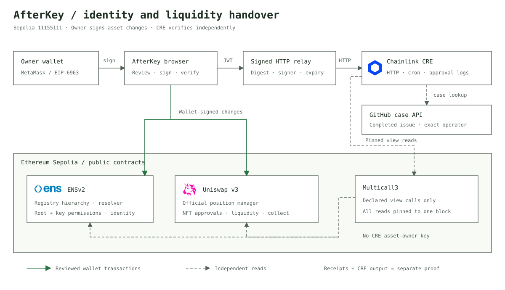
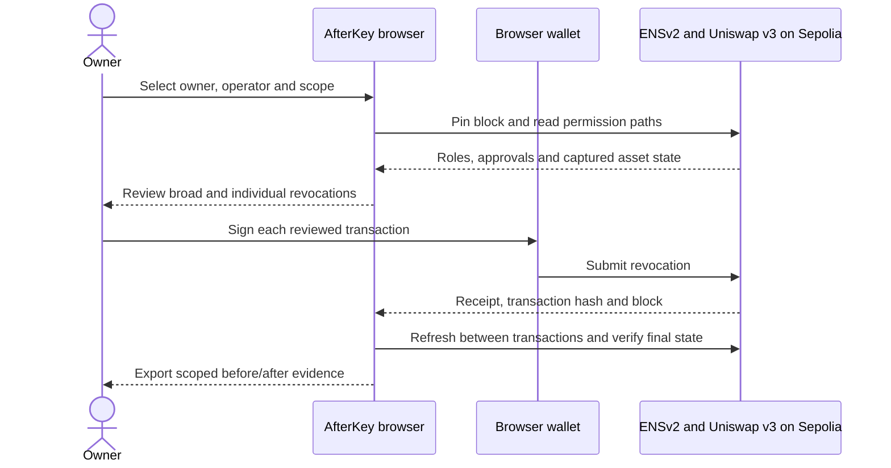
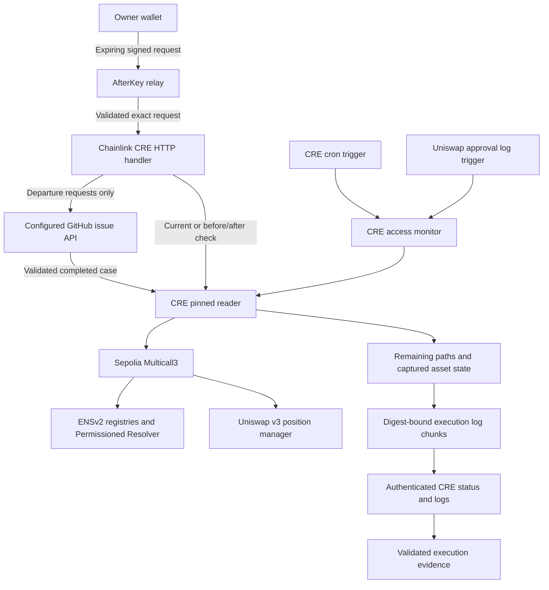

# Architecture and evidence flow

The browser scanner and Chainlink CRE read independently. Asset changes require the actual owner's wallet signature. CRE never receives that private key or executes the owner's revocations.

## Owner-reviewed offboarding

## Independent CRE monitoring

## Verification boundaries

| Artifact | Establishes |
| --- | --- |
| Wallet transaction receipt | A specified transaction was mined; decoded destination/calldata and historical state give it meaning |
| Browser before/after report | Configured modeled access and captured owner/identity/position state at the recorded blocks |
| CRE gateway acceptance | A signed trigger was accepted, not that its workflow succeeded |
| Authenticated CRE execution proof | The matching deployed workflow completed and emitted the reconstructed scope-bound output |

Recurring monitoring has recorded live execution proof. A distinct GitHub departure case, signed HTTP request, approval-event run or position transaction needs its own reference before it is claimed as demonstrated. See [current verification status](E2E_STATUS.md).
