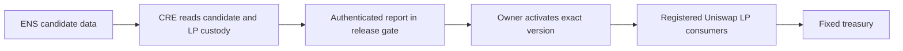

# ENS configuration releases

AfterKey separates an ENS candidate configuration from the version used by registered treasury consumers. An authorized record editor can stage a change without silently changing an active consumer's recipient or operator.

## Implemented flow

1. Deploy `ENSReleaseGate` for an owned ENSv2 name and its Permissioned Resolver.
2. Deploy one `ReleaseLPVault` per owner-held Uniswap v3 NFT. Register and deposit separately.
3. Publish `afterkey.release` as an ENS **data** record containing ABI-encoded `(address operator,address treasury,address manager,uint64 expiry)`.
4. CRE independently reads the gate, candidate resolver, complete registered-consumer list and NFT custody at one block. It checks the fixed treasury, official manager and a non-owner operator with a mandate of at most 30 days.
5. CRE signs and delivers the decision through `KeystoneForwarder`. The receiver validates the forwarder, workflow ID, workflow owner, chain, gate, candidate digest, baseline epoch, coverage hash and ten-minute report validity.
6. The owner activates the exact candidate. Both local policy and report checks run again onchain.
7. Operator collection includes the expected active digest and epoch. After promotion, operations prepared against the previous version revert. Collection pays the fixed owner treasury.



The active configuration is stored in the gate; changing the ENS candidate does not mutate it. Adding a consumer invalidates verification and blocks collection until complete coverage is approved again. Owners can pause collection or recover each NFT independently of ENS health or CRE availability. No arbitrary calls, token approvals, liquidity withdrawals or NFT transfers are available to operators.

## Setup in the application

Open **Change review → Set up consumers**. Use the existing owned ENS name, official Sepolia forwarder, and the CRE workflow owner and ID. Review and deploy with the owner wallet. Deploy/register/deposit a consumer for each NFT. Existing directly approved positions are not automatically moved or revoked.

Use **Export CRE coverage**, then run from the repository root:

```powershell
node --import tsx scripts/configure-release.ts C:/Users/sl/Downloads/afterkey-release-coverage.json
cd cre
cre workflow deploy . --target production
```

Record the returned workflow ID in `cre/deployment.json`; keep deployment/execution status truthful rather than copying old proof. In **Set up consumers**, enter the new `0x`-prefixed ID and review **Bind updated workflow ID**. Binding invalidates pending reports and increments the epoch. Rebuild/redeploy the frontend and relay with the matching configuration. Workflow-owner identity and forwarder are fixed at gate deployment.

Return to **Review change**: publish a candidate, review/sign CRE verification, wait for actual report delivery, read live state, then review/sign owner activation. `ACCEPTED` is not execution success. The UI will not trigger a gate absent from deployed coverage.

## Dependency coverage

**Dependencies** compares known names' resolver addresses and effective bundle IDs, including root-record fallback. Empty bundles are not labelled linked. Each name displays its observation block; reads across names are not an atomic global snapshot. CRE separately binds the exact ordered consumer list to its report at one block. This is declared coverage, not a universal ENS/application index. A candidate digest alone does not prove all downstream dependencies are known.

ENS setter rights are scoped by record key/type across the resolver, not by individual name. Use a dedicated resolver when an editor must be isolated from other names. Shared bundle links affect the whole bundle; the app does not silently create links or overwrite existing records to manufacture a demonstration.

## Proof status and limits

New contracts and browser/CRE paths are implemented and tested locally against a real local EVM with fixture contracts. These tests are not Sepolia deployment evidence or a deployed DON execution. The earlier offboarding transaction and CRE proofs cover the earlier workflow only. This release flow still requires owner-signed deployment/deposits, matching CRE deployment, report delivery and live activation/collection receipts.

Verification proves explicit rules and observed custody, not agent quality, investment returns, endpoint safety or absence of every permission. Candidate URI availability is not involved; configuration is ABI-encoded onchain. A malicious owner can recover assets or rebind a workflow; owner trust is explicit. This implementation is not a security audit.

## Source map

- `contracts/ENSReleaseGate.sol`: report authentication, activation and Uniswap consumer enforcement.
- `src/releases/model.ts`: shared configuration schema, policy and bundle grouping.
- `src/releases/client.ts`: live reads, bytecode verification, reviewed operations and known-name inspection.
- `src/releases/ui.ts`: setup, dependencies, candidate review, CRE trigger and execution.
- `cre/release.ts`: independently pinned reads, policy checks and onchain report submission.
- `server/cre-policy.ts`: owner-signed triggers restricted to deployed gate coverage.
- `tests/releases.test.ts`: EVM enforcement and failure cases.

## Primary references

- [ENS Permissioned Resolver](https://docs.ens.domains/ensv2/permissioned-resolver/): data records, bundle linking, defaults and setter permissions.
- [ENS Enhanced Access Control](https://docs.ens.domains/ensv2/enhanced-access-control/).
- [CRE consumer contracts](https://docs.chain.link/cre/guides/workflow/using-evm-client/onchain-write/building-consumer-contracts): forwarder identity and 62/64-byte metadata handling.
- [CRE onchain writes](https://docs.chain.link/cre/guides/workflow/using-evm-client/onchain-write/writing-data-onchain): signed reports and transaction status.
